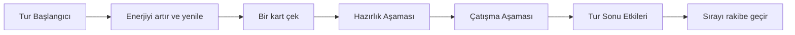

# Üç Koridorlu Kuşatma: Oyun Tasarımı ve Geliştirme Yol Haritası

**Belge sürümü:** 0.1  
**Hedef:** İlk oynanabilir ve dengelenebilir sürüm  
**Oyun biçimi:** Sıra tabanlı, iki oyunculu kart savaşı  
**İlk teslim biçimi:** Aynı cihazda iki oyuncu veya basit yapay zekâya karşı

## 1. Oyun Özeti

İki oyuncu, üç koridorda Kahraman ve Yapılarla cephe kurar. Kahramanlar rakip savunmayı temizler, Beceri kartlarıyla uzmanlaşır ve savaş içinde seviye atlar. Büyüler kritik anlarda çatışmanın yönünü değiştirir. Bir koridordaki bütün savunma kaldırıldığında o koridor rakibin Merkez Binasına açılır.

Oyunun tek temel zafer koşulu, rakip Merkez Binasının canını `0`a indirmektir.

### Tasarım hedefleri

- Kurallar ilk maçın ilk üç turunda anlaşılabilmeli.
- Oyuncu her tur en az iki anlamlı hamle arasında seçim yapmalı.
- Üç koridor da yalnızca görsel değil, stratejik olarak önemli olmalı.
- Kahraman ve Yapı yükseltmeleri maçın akışını değiştirmeli; yalnızca istatistik artırmamalı.
- Geri dönüş mümkün olmalı ancak önde olan oyuncunun başarısı anlamsızlaşmamalı.
- Hedef maç süresi `15–25 dakika` olmalı.

### İlk sürümde kapsam dışı olanlar

- Çevrimiçi çok oyunculu altyapı
- Kart paketi, koleksiyon ve hesap ilerlemesi
- Nadirlik üzerinden güç farkı
- Rakibin hamlesine araya girilen karmaşık tepki zincirleri
- Üçten fazla seviye veya ikiden fazla yükseltme dalı
- Turnuva modu, görev sistemi ve hikâye modu

---

## 2. Temel Terimler

| Terim | Anlamı |
|---|---|
| Tur | Tek bir oyuncunun başlangıçtan tur sonuna kadar yaptığı hamleler |
| Raund | İki oyuncunun da birer tur tamamlaması |
| Koridor | Sol, Orta veya Sağ savaş hattı |
| Ön Hat | Koridordaki ilk Kahraman konumu |
| Arka Hat | Koridordaki ikinci Kahraman konumu |
| Yapı Alanı | Koridorda bir Yapının yerleşebildiği konum |
| Hazır | Bu tur saldırabilecek veya hareket edebilecek kart |
| Tükenmiş | Bu tur saldırı veya hareket yapmış kart |
| Tecrübe | Kahraman veya Yapının seviye atlamak için biriktirdiği puan |
| Beceri | Bir Kahraman veya Yapıya bağlanan kalıcı geliştirme kartı |
| Büyü | Etkisi uygulandıktan sonra ıskartaya giden anlık kart |

---

## 3. Savaş Alanı

Her oyuncunun her koridorda üç kart alanı bulunur:

| Oyuncu alanı | Sol | Orta | Sağ |
|---|---|---|---|
| Yapı Alanı | 1 Yapı | 1 Yapı | 1 Yapı |
| Arka Hat | 1 Kahraman | 1 Kahraman | 1 Kahraman |
| Ön Hat | 1 Kahraman | 1 Kahraman | 1 Kahraman |

Her oyuncunun toplam kapasitesi:

- `6 Kahraman`
- `3 Yapı`
- `1 Merkez Binası`

Merkez Binası belirli bir koridora ait değildir. Açılan üç koridorun herhangi birinden saldırı alabilir.

### Koridor hedef sırası

Bir Kahraman saldıracağı zaman kendi koridorunda aşağıdaki ilk geçerli hedefe saldırabilir:

1. Rakip Ön Hat Kahramanı
2. Rakip Arka Hat Kahramanı
3. Rakip Yapı
4. Rakip Merkez Binası

Bu sıra, bir koridoru gerçekten açmayı zorunlu kılar. Kart açıklamasında açıkça yazmıyorsa hiçbir saldırı hedef sırasını atlayamaz.

### Ön ve Arka Hat farkı

- Ön Hattaki bütün Kahramanlar saldırabilir.
- Arka Hattaki yalnızca **Menzilli** özelliğine sahip Kahramanlar saldırabilir.
- Arka Hattaki yakın dövüş Kahramanı yedek savunma olarak bekler.
- Ön Hat boşsa Arka Hattaki Kahraman, bir yeniden konumlandırma eylemiyle öne alınabilir.

---

## 4. Maç Kurulumu

### Temel değerler

| Kural | Değer |
|---|---:|
| Merkez Binası canı | 30 |
| Deste boyutu | 30 |
| Başlangıç eli | 5 |
| Azami el boyutu | 8 |
| Başlangıç Enerjisi | 3/3 |
| Azami Enerji | 10 |
| Tur başına kart çekme | 1 |
| Kahraman başına Beceri yuvası | 1 |
| Yapı başına Beceri yuvası | 1 |

### Maç başlangıcı

1. Her oyuncu destesini karıştırır ve beş kart çeker.
2. Her oyuncu istemediği kartları bir kez destesine geri gönderip aynı sayıda yeni kart çeker.
3. İlk oyuncu rastgele belirlenir.
4. İkinci oyuncu, tek kullanımlık **Hazırlık** jetonu alır: Kendi turunda `+1 geçici Enerji` sağlar.
5. Her iki Merkez Binası `30 Can` ile oyuna başlar.

### Deste kurma sınırları

- Deste tam olarak 30 karttır.
- Aynı karttan en fazla iki kopya bulunabilir.
- Önerilen ilk deste dağılımı:
  - 12 Kahraman
  - 6 Yapı
  - 6 Beceri
  - 6 Büyü
- Merkez Binası deste kartı değildir.

İlk prototipte deste kurma ekranı yapılmayacak; iki oyuncu aynı sabit başlangıç destesini kullanacaktır.

---

## 5. Tur Akışı

### 5.1. Tur başlangıcı

Aktif oyuncu için sırasıyla:

1. Oyuncunun azami Enerjisi `1` artar; `10`u geçemez.
2. Mevcut Enerji, azami Enerjiye kadar tamamen yenilenir.
3. Oyuncu bir kart çeker.
4. Oyuncuya ait Tükenmiş kartlar Hazır hâle gelir.
5. “Tur başında” etkileri çözülür.

İlk oyuncunun ilk turunda azami Enerji artmaz; maça doğrudan `3/3 Enerji` ile başlar. Sonraki kişisel turlarında normal şekilde artar.

### 5.2. Hazırlık aşaması

Oyuncu Enerjisi yettiği sürece hamleleri istediği sırada yapabilir:

- Elden Kahraman oynamak
- Elden Yapı oynamak
- Beceri bağlamak
- Büyü kullanmak
- Seviye yükseltmek
- Bir Kahramanı yeniden konumlandırmak

Yeni oynanan Kahraman ve saldırabilen Yapılar **Tükenmiş** başlar. Kartta **Hızlı** özelliği varsa aynı tur Hazır başlar.

### 5.3. Çatışma aşaması

- Oyuncu Hazır kartlarıyla istediği sırada saldırır.
- Bir kart normalde tur başına en fazla bir kez saldırır.
- Saldırıdan sonra kart Tükenmiş olur.
- Hasar anında uygulanır; hedefin canı `0` olursa kart hemen yok edilir.
- İlk prototipte savunan kart otomatik karşı saldırı yapmaz.
- Oyuncu bütün kartlarıyla saldırmak zorunda değildir.

Hazırlık ve Çatışma aşamaları ilk prototipte arayüzde ayrı tutulmalıdır. Bu ayrım hedeflemeyi ve hata ayıklamayı kolaylaştırır. İleride testler gerek gösterirse iki aşama tek bir Ana Aşamada birleştirilebilir.

### 5.4. Tur sonu

1. “Tur sonunda” etkileri çözülür.
2. O tur kazanılan Tecrübe işaretlenir.
3. Süresi biten durum etkileri kaldırılır.
4. El sınırı sekizi aşıyorsa oyuncu sekiz karta düşene kadar kart atar.
5. Sıra rakibe geçer.

---

## 6. Kaynak Ekonomisi

Oyunda tek ana kaynak **Enerji**dir.

- Enerji her kişisel turda tamamen yenilenir.
- Azami Enerji 3'ten başlar ve kişisel tur başına 1 artarak 10'a ulaşır.
- Kullanılmayan Enerji sonraki tura taşınmaz.
- Geçici Enerji, yalnızca kazanıldığı tur kullanılabilir.

Bu model, mevcut biriken Altın sistemine göre daha öngörülebilir bir kart maliyeti eğrisi oluşturur ve oyuncunun birkaç tur hiçbir şey yapmadan kaynak biriktirmesini engeller.

### Önerilen maliyet aralıkları

| Kart türü | Genel maliyet |
|---|---:|
| Küçük Kahraman | 1–2 |
| Orta Kahraman | 3–4 |
| Büyük Kahraman | 5–7 |
| Yapı | 2–5 |
| Beceri | 1–3 |
| Büyü | 1–5 |

Bir kart veya etki, normal şartlarda bir turda `2`den fazla kalıcı Enerji avantajı üretmemelidir.

---

## 7. Kart Türleri

### 7.1. Kahraman

Kahramanların temel alanları:

- Saldırı
- Zırh
- Can
- Enerji maliyeti
- Özellik etiketleri
- Seviye ve Tecrübe
- Bağlı Beceri

Kahramanlar Ön veya Arka Hatta oynanabilir. Yeni oynanan Kahraman Tükenmiş başlar.

Önerilen ilk özellik etiketleri:

| Özellik | Etki |
|---|---|
| Menzilli | Arka Hattan saldırabilir |
| Hızlı | Oyuna girdiği tur saldırabilir veya hareket edebilir |
| Muhafız | Aynı koridordaki dost Yapıya giden ilk hasarı üstlenir |
| Kuşatma | Yapılara ve Merkez Binasına ilave hasar verir |
| Şifacı | Belirtilen koşulda dost karta can kazandırır |

İlk sürümde anahtar kelime sayısı beşi geçmemelidir.

### 7.2. Yapı

Yapılar yalnızca kendi Yapı Alanına oynanır ve koridor değiştiremez.

Yapı türleri:

- **Savunma:** Rakip ilerleyişini yavaşlatır veya hasar verir.
- **Üretim:** Geçici Enerji, kart çekme veya maliyet indirimi sağlar.
- **Destek:** Aynı koridordaki Kahramanları iyileştirir veya güçlendirir.

Saldırı değeri olan bir Yapı, Kahraman gibi tur başına bir kez saldırabilir. Saldırı değeri `0` olan Yapılar pasif etkileriyle değer üretir.

### 7.3. Beceri

Beceri kartları bir Kahraman veya Yapıya kalıcı olarak bağlanır.

- Her hedefin yalnızca bir Beceri yuvası vardır.
- Beceri hedefiyle birlikte yok edilir.
- Yeni Beceri takmak için dolu yuva boşaltılamaz; oyuncu mevcut Beceriyi değiştiremez.
- Uygun hedef kart üzerinde açıkça belirtilir: `Kahraman`, `Yapı` veya `Her İkisi`.
- Beceri sayısal bonus, yeni özellik veya aktif yetenek verebilir.

Mevcut projedeki `UpgradeCard`, ilk prototipte Beceri kartlarının teknik temeli olarak kullanılabilir. Oyuncuya gösterilen tür adı **Beceri** olmalıdır.

### 7.4. Büyü

Büyü oynandığında hedef seçilir, etki hemen çözülür ve kart ıskartaya gider.

- İlk prototipte Büyü zinciri veya rakip tepki penceresi yoktur.
- Büyü geçerli hedef yoksa oynanamaz ve Enerji harcanmaz.
- Büyüler normalde Merkez Binasını hedefleyemez.
- Merkez Binasına etki edebilen Büyünün kartında **Kuşatma Büyüsü** ifadesi bulunmalıdır.
- Bir Büyü tek başına Merkez Binasına `4`ten fazla hasar vermemelidir.

---

## 8. Hasar, Zırh ve İyileştirme

### Hasar çözümü

1. Hasar önce mevcut Zırhtan düşülür.
2. Artan hasar mevcut Candan düşülür.
3. Zırh kendiliğinden yenilenmez.
4. Can `0` olduğunda kart yok edilir ve yuvası boşalır.
5. Fazla hasar başka hedefe veya Merkez Binasına taşmaz.

Örnek: `4 Zırh` ve `6 Can` sahibi bir Kahraman `7 Hasar` alırsa Zırhı `0`, Canı `3` olur.

### İyileştirme

- İyileştirme Canı kartın azami Can değerinin üzerine çıkaramaz.
- İyileştirme Zırh yenilemez; kart bunu açıkça söylemelidir.
- Azami Can artıran bir geliştirme, mevcut Canı da aynı miktarda artırır.

### Durum etkileri

İlk prototipte yalnızca üç süreli durum kullanılmalıdır:

- **Sersemlemiş:** Bir sonraki Hazır olma adımını atlar.
- **Zehirli:** Sahibinin tur sonunda belirtilen hasarı alır.
- **Korumalı:** Alacağı bir sonraki hasarı belirtilen miktarda azaltır.

---

## 9. Hareket ve Yeniden Konumlandırma

Bir Kahraman, turda en fazla bir kez yeniden konumlandırılabilir.

- Maliyet: `1 Enerji`
- Hareketten sonra Kahraman Tükenmiş olur.
- Hedef yuva boş olmalıdır.
- İzin verilen hareketler:
  - Aynı koridorda Ön Hat ile Arka Hat arasında
  - Aynı sırada Sol ile Orta arasında
  - Aynı sırada Orta ile Sağ arasında
- Sol ile Sağ arasında tek hamlede geçilemez.
- Yapılar hareket edemez.

Bu kural, oyuncunun kaybedilen bir koridoru desteklemesine izin verirken her tur bütün ordunun yer değiştirmesini engeller.

---

## 10. Yükseltme Sistemi

Kahraman ve Yapılar üç seviyeye sahiptir.

| Seviye | Gereken toplam Tecrübe | Enerji bedeli |
|---|---:|---:|
| Seviye 1 | 0 | 0 |
| Seviye 2 | 2 | 1 |
| Seviye 3 | 6 | 2 |

Tecrübe eşiğine ulaşmak kartı otomatik yükseltmez. Oyuncu kendi Hazırlık aşamasında Enerji ödeyerek yükseltmeyi etkinleştirir.

### Kahraman Tecrübesi

- Bir turda ilk kez savaş hasarı verdiğinde `+1 Tecrübe`
- Rakip Kahraman veya Yapıyı yok ettiğinde `+1 Tecrübe`
- Bir Kahraman tur başına en fazla `2 Tecrübe` kazanabilir.
- Büyü veya pasif etkiden gelen hasar Kahramana Tecrübe kazandırmaz.

### Yapı Tecrübesi

- Kendi temel etkisi bir turda ilk kez başarıyla çalıştığında `+1 Tecrübe`
- Saldırabilen Yapı bir hedefi yok ettiğinde `+1 Tecrübe`
- Bir Yapı tur başına en fazla `1 Tecrübe` kazanabilir.

### Dal seçimi

Seviye 2'de oyuncuya iki farklı dal sunulur. Seviye 3, seçilen dalı güçlendirir; diğer dala geçilemez.

Örnek Şövalye gelişimi:

| Seviye | Muhafız dalı | Düellocu dalı |
|---|---|---|
| 2 | +2 Zırh ve Muhafız | +1 Saldırı; Kahramanlara +1 hasar |
| 3 | Tur başında 1 Zırh yeniler | Bir Kahramanı yok edince Hazır olur; turda bir kez |

Örnek Okçu Kulesi gelişimi:

| Seviye | Seri Atış dalı | Keskin Atış dalı |
|---|---|---|
| 2 | Saldırısı iki hedefe bölünebilir | +2 Saldırı, yalnızca tek hedef |
| 3 | İkinci hedefe verilen hasar azalmaz | Zırha verdiği ilk 2 hasar doğrudan Cana geçer |

### Kart yok edildiğinde

- Kazandığı bütün Tecrübe ve seviyeler kaybolur.
- Bağlı Beceri de ıskartaya gider.
- Kart yeniden oynanırsa Seviye 1 olarak başlar.

---

## 11. Merkez Binası ve Zafer

- Her Merkez Binası `30 Can` ile başlar.
- Merkez Binasının Zırhı ve saldırı değeri yoktur.
- Bir koridorda rakibin Ön Hat, Arka Hat ve Yapı alanları boşsa o koridor açıktır.
- Açık koridordaki Kahraman veya saldırabilen Yapı, normal saldırısını Merkez Binasına yöneltebilir.
- Merkez Binasının Canı `0` olduğunda mevcut etki tamamlanır ve maç hemen biter.

### Deste bittiğinde

Kart çekmesi gereken oyuncunun destesi boşsa Merkez Binası **Yorgunluk Hasarı** alır:

- İlk başarısız çekişte 1
- İkincide 2
- Üçüncüde 3
- Sonraki her başarısız çekişte hasar 1 artar

Bu, savunmaya kilitlenen maçların doğal biçimde bitmesini sağlar; ayrı bir süre zaferi oluşturmaz.

---

## 12. Örnek Raund

Oyuncu 1'in Orta Ön Hattında Şövalye, Orta Arka Hattında Okçu vardır. Oyuncu 2'nin aynı koridorunda Ön Hatta Troll ve Yapı Alanında Altın Madeni bulunur.

1. Oyuncu 1 turuna `5/5 Enerji` ile başlar ve bir kart çeker.
2. Şövalyeye `1 Enerji` karşılığında Çelik Kalkan Becerisi bağlar.
3. Sağ koridora `2 Enerji` karşılığında Çapulcu oynar; yeni oynandığı için Tükenmiştir.
4. Çatışma aşamasında Şövalye hedef sırası nedeniyle Trolle saldırır.
5. Okçu Menzilli olduğu için Arka Hattan yine Trolle saldırır.
6. Troll yok edilirse Orta koridorda sıradaki hedef Altın Madenidir; ancak iki saldırgan da artık Tükenmiştir.
7. Tur sonunda Şövalye ve Okçu, o tur ilk kez savaş hasarı verdikleri için birer Tecrübe kazanır.
8. Sıra Oyuncu 2'ye geçer; Oyuncu 2 Orta koridoru yeniden savunmak ile Sağdaki yeni tehdide cevap vermek arasında seçim yapar.

---

## 13. İlk Kart Seti

İlk denge testleri için 24 farklı kart yerine 24 kartlık küçük bir havuz ve 30 kartlık sabit deste kullanılabilir. Önerilen altı kartlık tür listeleri:

### Kahramanlar

1. Şövalye — Zırhlı ön hat ve Muhafız dalı
2. Okçu — Menzilli arka hat saldırısı
3. Çapulcu — Hızlı koridor baskısı
4. Peri — İyileştirme ve destek
5. Büyücü — Büyü kullanımıyla güçlenen saldırgan
6. Troll — Yüksek Can ve kuşatma gelişimi

### Yapılar

1. Altın Madeni — Sınırlı geçici Enerji üretimi
2. Kışla — Aynı koridora oynanan Kahramanları destekler
3. Okçu Kulesi — Menzilli savunma
4. Şifa Çadırı — Tur sonunda iyileştirme
5. Sur — Yüksek Can, düşük veya sıfır saldırı
6. Mana Kuyusu — Büyü maliyeti indirimi

### Beceriler

1. Çelik Kalkan — Zırh ve Can
2. Keskin Nişancılık — Menzilli saldırı güçlendirmesi
3. Hız Eğitimi — Hızlı veya hareket indirimi
4. Güçlendirilmiş Temel — Yapı Canı
5. Gözetleme Düzeneği — Yapıya menzil veya hedef avantajı
6. Rün Bağı — Büyü kullanıldığında geçici bonus

### Büyüler

1. Kutsal Işık — İyileştirme
2. Zehir Yağmuru — Tek hedef hasarı ve Zehir
3. Yer Değiştiren Rüzgâr — Kahramanı komşu koridora iter
4. Buz Mührü — Sersemletme
5. Yıldırım — Doğrudan kart hasarı
6. Onarım Ritüeli — Yapı iyileştirme veya Zırh yenileme

Önerilen ilk sabit deste, her Kahramandan iki kopya ve diğer 18 karttan birer kopya kullanarak 30 karta tamamlanır.

---

## 14. Denge Hedefleri

İlk testlerde aşağıdaki aralıklar hedeflenmelidir:

| Ölçüm | Hedef |
|---|---:|
| Ortalama maç süresi | 15–25 dakika |
| Ortalama raund sayısı | 8–12 |
| İlk oyuncu kazanma oranı | %48–52 |
| Maç başına ilk Seviye 2 zamanı | 3.–5. raund |
| Maç başına Seviye 3 kart sayısı | Oyuncu başına 1–3 |
| İlk Merkez Binası hasarı | 4.–7. raund |
| Kullanılmadan biten Enerji | Tur başına ortalama 0–2 |

### Denge koruma kuralları

- Tek kart, aynı maliyetteki rakip kartı her durumda etkisiz kılmamalı.
- Bir Büyü, aynı maliyetli tam canlı Kahramanı koşulsuz yok etmemeli.
- Üretim Yapıları kendi maliyetini iki turdan önce tamamen geri kazandırmamalı.
- Seviye 3 kart güçlü olmalı ancak tek başına üç koridoru kontrol edememeli.
- Merkez Binasına tek karttan gelen normal hasar `6`yı geçmemeli.
- Kilit etkiler en fazla bir tam tur sürmelidir.

---

## 15. Mevcut Projenin Durumu

### Hazır veya büyük ölçüde hazır

- Godot 4.7 proje ve ana savaş alanı
- İki oyuncu için üç koridor × Ön Hat, Arka Hat ve Yapı alanı
- Sol, Orta ve Sağ koridor kimlikleri ile aynalanmış savaş alanı yerleşimi
- Kart türü, kart sahibi ve Beceri hedef türüne göre yuva doğrulaması
- Açık koridor sorgusu, durum sinyali ve boş yuva görsel geri bildirimi
- JSON tabanlı kart veritabanı
- Kahraman, Yerleşim/Yapı, Özel Güç/Büyü ve Geliştirme kart sınıfları
- Nadirliğe göre kart şablonları
- Deste oluşturma, karıştırma ve ele kart çekme
- Mulligan, Hazırlık/Çatışma/Tur Sonu akışı, yenilenen Enerji ve Hazırlık jetonu
- Oyuncu sırası, kart sahipliği ve geçersiz hamlede maliyet koruması
- Kart sürükleme, uygun yuvayı bulma ve yuvaya yerleştirme
- Hazır/Tükenmiş, hedef önceliği, Zırh/Can hasarı, ölüm ve saldırı çözümü
- Merkez Binası canı, açık koridor saldırısı ve oyun sonu kilidi
- Merkezi `EffectResolver` üzerinden Beceri, Büyü, pasif, üretim ve durum etkileri
- Tek Beceri yuvası, hedefle birlikte yok olma ve kart türü hedef sınırları
- Menzilli, Hızlı, Muhafız, Kuşatma ve Şifacı özellikleri
- Sersemlemiş, Zehirli ve Korumalı durumları
- Altı başlangıç Büyüsü için hedefleme modu ve yasal hedef vurgusu
- Hazırlık aşamasında Ön/Arka ve komşu koridor Kahraman hareketi, 1 Enerji maliyeti ve tur sınırı
- Kahraman/Yapı Tecrübesi, tur başına kazanım sınırları ve aktif Seviye 2/3 yükseltmeleri
- Geri alınamaz iki dallı gelişim; Şövalye, Troll, Enerji Ocağı ve Okçu Kulesi için sekiz çalışan Seviye 3 yolu
- Kart eylem paneli, hareket hedef vurgusu ve kart üzerinde Seviye/Tecrübe/dal göstergesi
- Duyarlı savaş alanı ve kart önizleme arayüzü
- İki satırlı aşama yönlendirmesi, geçici faz bandı ve kalıcı hızlı kural rehberi
- Saldırı izi; hasar, iyileştirme, ölüm, Tecrübe ve yükseltme animasyonları ile olay tabanlı kısa sesler
- Açık koridordan rakip Merkez Binasına uzanan, aktif oyuncuya göre renklendirilmiş rota
- Savaş alanı ölçeğinden bağımsız Seviye, Hazır/Tükenmiş ve çok satırlı geçici durum rozetleri
- Beş anahtar kelimelik ortak sözlük ve ortak hedef/tetikleyici diliyle cilalanmış 30 oynanabilir kart
- İlk maçta otomatik açılan, beş adımlı, atlanabilir ve sonradan hızlı rehberle desteklenen öğretici
- Başla akışında Kolay, Orta ve Zor seçenekli tek oyunculu yapay zekâ karşılaşması
- Önce yasal hamle havuzu üreten, sonra zorluk seviyesine göre puanlayan deterministik AI planlayıcısı
- Tohumlanmış sabit deste, artan Yorgunluk Hasarı ve atomik aynı-anda-ölüm çözümü
- Yerel JSON Lines maç telemetrisi ve gerçek kural çözümleyicileriyle çalışan 50 maçlık denge paketi

### Aşama 0–7 kapsamında tamamlanan dönüşümler

| Eski durum | Uygulanan hedef |
|---|---|
| Biriken Altın ve tur başına +2 | Yenilenen ve her tur büyüyen Enerji |
| Başlangıç eli 8 | Başlangıç eli 5 |
| Merkez Binası canı 200 | Merkez Binası canı 30 |
| `UpgradeCard` altyapısı | Görünen türü Beceri olan kalıcı tek yuva ve ortak etki çözümü |
| Yeniden konumlandırma yok | Merkezi doğrulamalı, maliyetli ve turda bir kez Kahraman hareketi |
| Maç içi ilerleme yok | Olay tabanlı Tecrübe, ücretli Seviye 2/3 ve kilitli iki dallı gelişim |
| Yalnızca yuva çerçevesiyle açık koridor | Merkez Binasına uzanan kalıcı, kesik saldırı rotası |
| Ölçekle küçülen durum metinleri | Yuva üstünde bağımsız Seviye, savaş ve geçici durum rozetleri |
| Parçalı kart dili | Beş anahtar kelimelik sözlük ve 30 kartta ortak hedef/tetikleyici metni |
| Yerel iki oyuncuya sabit başlangıç | Kolay, Orta ve Zor AI seçimiyle tek oyunculu maç kurulumu |
| Rastgele ve gözlemlenemeyen maçlar | Tohumlanmış desteler, JSONL telemetri ve 50 maçlık tekrarlanabilir denge paketi |

### MVP sistem durumu

- Yol haritasındaki Aşama 0–7 ana sistemlerinin tamamı uygulanmıştır.
- Son 50 maçlık koşunun ayrıntıları `PHASE7_DENGE_RAPORU.md` dosyasında kayıtlıdır.

---

## 16. Geliştirme Yol Haritası

Süreler, projeyi tanıyan tek geliştirici için yaklaşık iş günü tahminidir. Her aşama bir öncekinin kabul kriterleri karşılandıktan sonra başlamalıdır.

### Aşama 0 — Kuralları kilitleme ve veri sözleşmesi

**Tahmin:** 1–2 gün

Yapılacaklar:

- Bu belgedeki sayısal kuralları tek bir oyun ayarı kaynağına taşımak.
- Kart veri şemasına `tags`, `valid_positions`, `effect_id`, `level_paths` alanlarını eklemek.
- Oyuncuya görünen kart türlerini Kahraman, Yapı, Beceri ve Büyü olarak sabitlemek.
- Kartın temel değerleri ile maç içindeki mevcut değerlerini ayırmak.
- Durumları açık enumlarla tanımlamak: aşama, konum, kart türü ve hedef türü.

Kabul kriterleri:

- Bütün kart JSON dosyaları hatasız yüklenir.
- Eksik veya geçersiz alanlar anlaşılır hata mesajı üretir.
- Oyun kuralları farklı scriptlerde tekrarlanan sabitler olarak tutulmaz.

### Aşama 1 — Üç koridorlu savaş alanı

**Durum:** Tamamlandı — 15 Temmuz 2026  
**Tahmin:** 2–4 gün

Yapılacaklar:

- `battlefield.tscn` içindeki mevcut 4×2 yuva düzenini iki oyuncu için 3×3 düzene çevirmek.
- Her yuvaya `lane_id` ve `position_type` vermek.
- `CardSlot.can_accept_card()` kontrolünü kart türü ve konuma göre genişletmek.
- Sol, Orta ve Sağ koridorları görsel olarak ayırmak.
- Dolu, geçerli hedef, geçersiz hedef ve saldırıya açık koridor durumlarını renkle göstermek.

Kabul kriterleri:

- Kahraman yalnızca Ön veya Arka Hatta oynanır.
- Yapı yalnızca Yapı Alanına oynanır.
- Her iki oyuncunun bütün yuvaları farklı çözünürlüklerde doğru hizalanır.
- Açık koridor bilgisi koddan güvenilir biçimde sorgulanabilir.

### Aşama 2 — Tur, Enerji ve deste akışı

**Durum:** Tamamlandı — 15 Temmuz 2026  
**Tahmin:** 2–3 gün

Yapılacaklar:

- `GameManager` içindeki Altın modelini azami/mevcut Enerji modeline dönüştürmek.
- Hazırlık, Çatışma ve Tur Sonu aşamalarını durum makinesiyle yönetmek.
- Başlangıç eli, mulligan, el sınırı ve otomatik tur çekişini uygulamak.
- Hazırlık jetonunu eklemek.
- Kartların yalnızca doğru aşamada oynanmasını sağlamak.

Kabul kriterleri:

- İlk beş raundun Enerji değerleri her oyuncu için doğru ilerler.
- Geçersiz hamle Enerji harcamaz.
- Tur yalnızca aktif oyuncu tarafından ilerletilebilir.
- Deste ve el sınırları kural belgesiyle aynıdır.

### Aşama 3 — Çatışma ve maçın tamamlanması

**Durum:** Tamamlandı — 15 Temmuz 2026  
**Tahmin:** 3–5 gün

Yapılacaklar:

- Hazır/Tükenmiş durumunu eklemek.
- Saldırgan seçimi ve yasal hedef vurgusunu uygulamak.
- Koridor hedef önceliğini merkezi bir çözümleyicide uygulamak.
- Zırh, Can, hasar, iyileştirme ve kart ölümünü eklemek.
- Açık koridordan Merkez Binasına saldırıyı etkinleştirmek.
- Oyun sonu ekranını gerçek savaş sonucuna bağlamak.

Kabul kriterleri:

- Yalnızca Kahraman kartlarıyla baştan sona bir maç tamamlanabilir.
- Hedef sırası hiçbir normal saldırıyla atlanamaz.
- Kart ölünce yuvası güvenilir biçimde boşalır.
- Merkez Binası `0 Can` olduğunda başka hamle yapılamaz.

Bu aşama ilk gerçek **oynanabilir dikey dilim**dir.

### Aşama 4 — Dört kart türünün tamamlanması

**Durum:** Tamamlandı — 15 Temmuz 2026  
**Tahmin:** 4–6 gün

Yapılacaklar:

- Yapıların pasif, üretim ve saldırı etkilerini çalıştırmak.
- `UpgradeCard` sunumunu Beceriye dönüştürmek ve hedef sınırlarını uygulamak.
- Tek Beceri yuvası ve hedefle birlikte yok olma kuralını eklemek.
- Büyü hedefleme modunu ve ilk altı Büyü etkisini uygulamak.
- Menzilli, Hızlı, Muhafız, Kuşatma ve Şifacı özelliklerini eklemek.
- Sersemlemiş, Zehirli ve Korumalı durumlarını uygulamak.

Kabul kriterleri:

- Her kart türünden en az üç kart doğru hedefle oynanabilir.
- Bütün etkiler aynı merkezi etki çözüm yolunu kullanır.
- Geçersiz Beceri/Büyü hedefi maliyet harcatmaz.
- Etki açıklaması ile gerçek sonuç arasında fark yoktur.

### Aşama 5 — Hareket ve yükseltme

**Durum:** Tamamlandı — 15 Temmuz 2026  
**Tahmin:** 3–5 gün

Yapılacaklar:

- Ön/Arka ve komşu koridor hareketini uygulamak.
- Hareket maliyeti, Tükenmiş durumu ve tur başına hareket sınırını eklemek.
- Kahraman ve Yapı Tecrübe kazanımını uygulamak.
- Seviye yükseltme maliyetlerini eklemek.
- İki dallı seçim arayüzünü hazırlamak.
- Seviye ve seçilen dalı kart üzerinde görünür hâle getirmek.

Kabul kriterleri:

- Tecrübe yalnızca tanımlı olaylardan ve tur sınırlarına uygun kazanılır.
- Seviye 2 seçimi geri alınamaz.
- Seviye 3 yalnızca seçilmiş dalı geliştirir.
- Kart yok edildiğinde geçici ilerleme temizlenir.
- En az iki Kahraman ve iki Yapı için iki dal da çalışır.

### Aşama 6 — Kullanıcı deneyimi ve içerik

**Durum:** Tamamlandı — 15 Temmuz 2026  
**Tahmin:** 4–6 gün

Yapılacaklar:

- Hazırlık/Çatışma aşaması göstergesi eklemek.
- Saldırı, hasar, iyileştirme, ölüm ve yükseltme animasyonları eklemek.
- Koridor açık olduğunda Merkez Binasına uzanan saldırı yolunu göstermek.
- Kart metinlerini ortak anahtar kelime sözlüğüne göre yeniden yazmak.
- 24 başlangıç kartını tamamlamak.
- İlk maç için kısa, atlanabilir öğretici hazırlamak.
- Sesli ve görsel geri bildirim eklemek.

Kabul kriterleri:

- Yeni bir oyuncu dış açıklama olmadan kart oynayabilir, saldırabilir ve tur bitirebilir.
- Geçersiz hamlenin nedeni ekranda anlaşılır biçimde gösterilir.
- Bütün geçici durumlar ve kart seviyeleri savaş alanında okunabilir.
- 1280×720 hedef çözünürlükte hiçbir temel kontrol taşmaz.

### Aşama 7 — Yapay zekâ, test ve dengeleme

**Durum:** Tamamlandı — 15 Temmuz 2026  
**Tahmin:** 5–8 gün

Yapılacaklar:

- Önce yasal hamle üreten, sonra basit puanlamayla hamle seçen yapay zekâ eklemek.
- Birim testleri ve deterministik savaş senaryoları oluşturmak.
- Maç telemetrisini yerel loga yazmak.
- En az 50 otomatik veya gözlemlenen test maçı çalıştırmak.
- Aşırı güçlü/zayıf kartları ve ilk oyuncu avantajını ayarlamak.
- Kilitlenme, boş deste ve aynı anda ölüm gibi uç durumları test etmek.

Kabul kriterleri:

- Yapay zekâ geçersiz hamle yapmadan maçı bitirebilir.
- En az on ardışık maç hata veya kilitlenme olmadan tamamlanır.
- Maç süresi ve raund sayısı hedef aralıklarına yaklaşır.
- Tek bir açılış dizisi belirgin biçimde zorunlu değildir.
- Kaydedilen tüm kritik P0/P1 hataları kapatılmıştır.

Doğrulama özeti:

- 50/50 maç tamamlandı; geçersiz AI hamlesi ve kilitlenme: `0`.
- Ortalama `12,66` raund; ilk oyuncu kazanma oranı `%48`.
- 20 farklı açılış kartı görüldü; tek bir zorunlu açılış oluşmadı.
- Yeterli örnekli 30 kart içinde kullanım-kazanma oranı `%20–80` dışına çıkan kart olmadı.

### Toplam tahmin

- **Oynanabilir kahraman odaklı dikey dilim:** Aşama 0–3, yaklaşık 8–14 iş günü
- **Bütün temel sistemleri içeren alfa:** Aşama 0–5, yaklaşık 15–25 iş günü
- **İlk dengelenebilir MVP:** Aşama 0–7, yaklaşık 24–39 iş günü

Bu tahmin kart çizimlerinin ve kapsamlı ses üretiminin dışarıdan hazır geldiğini varsayar.

---

## 17. Teknik Mimari Önerisi

### Sorumlulukların ayrılması

| Bileşen | Sorumluluk |
|---|---|
| GameManager | Maç durumu, aktif oyuncu, aşama, Enerji ve zafer |
| BattlefieldState | Koridorlar, yuvalar ve kartların maç içi konumları |
| CombatResolver | Yasal saldırı hedefi, hasar ve ölüm çözümü |
| EffectResolver | Beceri, Büyü, pasif ve durum etkileri |
| CardDatabase | Değişmeyen kart tanımları |
| BaseCard ve alt sınıflar | Kartın görsel sunumu ve kullanıcı etkileşimi |
| BattlefieldUI | HUD, hedef vurgusu, animasyon ve bildirimler |

Kart düğümleri tek doğruluk kaynağı olmamalıdır. Oyun kuralları arayüz düğümlerinden bağımsız çalışırsa yapay zekâ, test ve ileride çevrimiçi oyun eklemek daha kolay olur.

### Önerilen olaylar

- `phase_changed`
- `energy_changed`
- `card_played`
- `card_moved`
- `attack_declared`
- `damage_applied`
- `card_destroyed`
- `experience_changed`
- `card_leveled_up`
- `hq_damaged`
- `game_over`

Her oyun olayı bir kez üretilmeli; arayüz bu olayları dinleyerek görsel sonucu göstermelidir.

---

## 18. Test Planı

### Kural testleri

- Enerji artışı ve yenilenmesi
- Kart maliyeti ve geçersiz hamlede geri ödeme
- Koridor hedef önceliği
- Zırh taşması ve Can hasarı
- Kart ölümü ve yuva boşalması
- Menzilli Arka Hat saldırısı
- Hareket maliyeti ve Tükenmiş durumu
- Beceri hedef uygunluğu
- Büyü hedef uygunluğu
- Tecrübe tur sınırları
- Yükseltme dalı kilidi
- Açık koridordan Merkez Binası saldırısı
- Yorgunluk hasarının artışı

### Entegrasyon senaryoları

1. Yalnızca Kahramanlarla bir koridoru açıp maçı bitirme
2. Yapı arkasında savunma kurup Büyüyle hattı kırma
3. Beceri takılı Seviye 3 kartın yok edilmesi
4. Kahramanın koridor değiştirip aynı tur saldırmasının engellenmesi
5. Son kart çekildikten sonra Yorgunluk Hasarının başlaması
6. Merkez Binası ölümünde bekleyen animasyon ve girişlerin durması

### Kaydedilecek denge verileri

- Kazanan ve başlayan oyuncu
- Toplam tur ve raund sayısı
- İlk Merkez Binası hasarının raundu
- Her tur harcanmayan Enerji
- Kart türüne göre oynanma ve elde kalma oranı
- Koridor başına saldırı ve hasar
- Seviye 2/3'e ulaşan kartlar
- Kullanıldığında kazanma oranı olağan dışı yükselen kartlar

---

## 19. MVP Tamamlanma Tanımı

MVP aşağıdaki koşulların tamamı sağlandığında bitmiş sayılır:

- İki oyuncu veya oyuncu ile yapay zekâ 30 kartlık destelerle maç yapabilir.
- Üç koridor, Ön/Arka Hat ve Yapı alanları eksiksiz çalışır.
- Kahraman, Yapı, Beceri ve Büyü kartlarının her birinden en az altı farklı kart vardır.
- Saldırı, hareket, Büyü, Beceri ve yükseltme akışları anlaşılır arayüze sahiptir.
- Kahraman ve Yapılar iki farklı daldan Seviye 3'e ulaşabilir.
- Merkez Binası hasarı, Yorgunluk ve oyun sonu hatasız çalışır.
- Maçlar hedef süreye yakın tamamlanır.
- En az on ardışık tam maç kritik hata olmadan oynanmıştır.
- Bilinen kritik veya yüksek öncelikli hata kalmamıştır.
